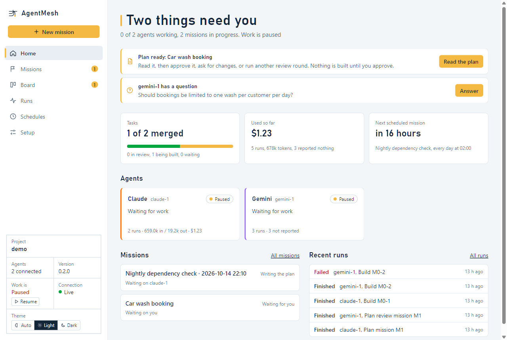
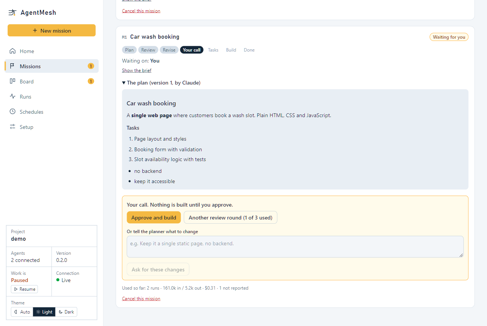

# AgentMesh

You describe what you want built. One AI coding agent writes a plan, the others look for gaps, you approve it, and then they build it in parallel, checking each other's work. You watch and steer from a page in your browser.

Everything runs on your own computer, with your own logins for each agent tool. AgentMesh has no server of its own and sends nothing anywhere; the agent tools talk to their own providers as they always do.

```
your brief ─► plan (agent you pick) ─► gaps found (the other agents) ─► final plan
          ─► YOU approve ─► tasks split between the agents ─► each task built on its own branch
          ─► another agent reviews it ─► the checks pass ─► merged into your main branch
```



The cockpit opens on **Home**: one sentence on what is happening, and what only you can do about it. The picture above is a demo project with made-up missions. Dark mode follows your system, or you can pick it.

**New here? Follow [INSTALL.md](INSTALL.md)**: it goes step by step from an empty computer to your first finished mission.

## Quick start

You need **Node 22+**, **git**, and at least one agent tool (**Claude Code** or **Google Antigravity**) that you have signed in to once. [INSTALL.md](INSTALL.md) explains each one.

```
npm install -g https://github.com/zetabyte1195-cyber/agentmesh/releases/latest/download/agentmesh.tgz

mkdir carwash
cd carwash
agentmesh init --yes                 # set up this folder (starts a git repository if it is empty)
agentmesh doctor --install --fix --test   # installs what is missing (asks first), then tests each agent
agentmesh start                      # opens the cockpit in your browser
```

In the cockpit:

1. **Setup** shows your agents, whether each works, and how your project is checked.
2. **Missions**: describe what you want (or start from one of the ready-made ideas), pick who writes the plan and who looks for gaps, press **Start**.
3. Read the plan when it says **Waiting for you**. **Approve and build**, or ask for another review round, or tell the planner what to change. Nothing is built until you approve.
4. Watch the tasks appear and finish. **Home** lists everything that needs you: a plan to read, a question to answer, an agent that gave up. The **Board** has the detail, and **Runs** shows every agent run.



To use an existing project, run `agentmesh init` inside it instead. It must be a git repository with at least one commit.

## What AgentMesh does to your files

- Agents never edit the files you are looking at. Each task gets its **own copy on its own git branch** under `.agentmesh/` (a hidden folder that git ignores through the repository's local `.git/info/exclude`; your `.gitignore` is not touched).
- Planning happens in a throwaway copy that is deleted when the step ends.
- When another agent has reviewed a task, and your project check passes, the work is merged into your main branch as **ordinary git commits** in your name. Nothing is ever pushed anywhere.
- If you have uncommitted edits in the same files a task changes, the merge waits instead of touching them. Leave your working folder tidy while a mission runs, or work on a different branch.
- `agentmesh init` adds a few files to the repository (`CLAUDE.md`, `GEMINI.md` or similar instruction files for the agents, and two small connection files). It commits only those.
- The cockpit listens only on your own computer. Each login link works once; `agentmesh login` gives you a new one.
- **Several projects:** each project has its own AgentMesh and its own cockpit. Give each its own port (`agentmesh start --port 8944`); the title block names the project, so open tabs can be told apart.
- **Undoing a mission.** There is no undo button, on purpose: it would have to rewrite your branch. What a mission built is ordinary commits on your main branch, one after another, each ending with an `AgentMesh-Agent:` line. To take it back, first keep a safety copy (`git branch before-undo`), find the last commit from before the mission (`git log --oneline`), then either `git revert --no-commit <that commit>..HEAD` followed by `git commit` (keeps the history and adds one commit that undoes everything after that point, including anything of your own), or, if you have not pushed and nothing of yours came after, `git reset --hard <that commit>`. The mission stays listed in the cockpit as done.

## Checking your project

Before anything is merged, AgentMesh runs one command that decides whether the project still works. `init` works it out from your files (`npm test`, `python -m pytest -q`, `go test ./...`, `cargo test`, `dotnet test`, `make test`, ...). Use a command that covers the whole project, not one that names a single file: it is run for every task. If it cannot tell, or the project is brand new, the **Setup** tab lets you type it, or (for a brand-new project) merge after review alone until you have tests.

## More the cockpit can do

- **Tell me when something needs me.** In **Setup**, switch on desktop notifications (they work while the cockpit page is open in any tab), and/or give a webhook address that is called when a plan is ready, an agent asks you something, an agent gives up, a mission finishes, or a mission reaches its spending limit. The webhook body is JSON, signed with a secret you choose (`X-AgentMesh-Signature`, HMAC-SHA256 of the body), so a receiver can check it. **Send a test** shows what arrives. It has been tested against a plain HTTP receiver, not against a particular chat or phone service.
- **About this project.** A short note (up to 3,500 characters, in **Setup**) that is added to every agent's instructions: how the project is run, conventions, what to leave alone.
- **A spending limit per mission.** When you start a mission (or later, on its card) you can say "stop around $5" or "around 2 million tokens". Once the mission has used about that much, no more runs start for it, you are told, and you choose: raise the limit and it carries on, or cancel it. Other missions are not held up. It counts only what the agent tools report: Claude Code reports dollars and tokens, Antigravity tokens only, a tool in plain-text mode nothing, so a dollar limit cannot see a tool that reports no cost. Cached input is not counted. A run already going finishes, so a mission can go a little over. Scheduled missions have no limit of their own yet; set one on the mission's card once it starts.
- **Start from an idea.** **Missions** offers ready-made briefs (a booking page, a website, a REST API, a command-line tool, a browser game, an automation script, adding tests, fixing a problem), and you can save your own.
- **Schedules.** Start a mission on a timetable (daily, weekly, every so many hours, or a cron line) or when another mission finishes, for example a nightly dependency check. A schedule never approves anything: its plan waits for you like any other, and a schedule never starts a second mission while the last one is still going.
- **Playbooks.** Reusable instructions kept as files in `.agentmesh/playbooks/` (for example how you write release notes). Agents see each playbook's name and one line, and read the whole text only when it applies.
- **Runs.** Every agent run, what it did, how long it took and what it used. "Finished" only means the tool exited without an error, so a run that left its task exactly as it was is marked **Finished, but nothing changed**.
- **Stuck-loop protection.** A run that makes the same tool call three times in a row and gets the same result each time is stopped and counts as failed, so it is retried and then handed to you like any other failure. It does not catch a loop that alternates between two calls, or one whose result changes every time. **Setup** says which tools this works with: today, Claude Code.
- **Updates.** `agentmesh update` installs the newest release. AgentMesh does not look for updates unless you ask or switch on the daily check in **Setup**.
- **Containers (experimental).** Run each agent inside a container so it can only touch its task's folder. See [docs/container-mode.md](docs/container-mode.md), including what it does not check.

## Commands

| Command | What it does |
|---|---|
| `agentmesh init [--yes] [--agents claude,gemini] [--port N] [--no-commit]` | Set up the current folder. |
| `agentmesh doctor [--install] [--fix] [--test] [--yes]` | Check the machine and project. `--install` offers to install what is missing (git, Claude Code, Antigravity, and any tool you added from a recipe) and asks before each one; `--fix` allows AgentMesh's tools in Antigravity's settings (a backup is kept); `--test` runs each agent for real (about a minute each, a little of your quota). |
| `agentmesh start [--background] [--port N] [--no-open]` | Start AgentMesh and open the cockpit. With `--background` it keeps running after you close the window, and restarts itself if it crashes. |
| `agentmesh login` | A fresh cockpit link, if you closed the page or lost the link. |
| `agentmesh status [--json]` | Agents, missions, tasks, file locks and questions waiting for you. Works whether AgentMesh is running or not. |
| `agentmesh dispatch pause\|resume [agent]` | Stop or restart handing out work (to everyone, or one agent). Runs already going finish normally. |
| `agentmesh stop` | Stop AgentMesh. Running agents stop with it; nothing is lost. |
| `agentmesh export [file]` | Write the board and timeline as a Markdown file. |
| `agentmesh update [--check] [--yes]` | Install the newest release. `--check` only says whether there is one; `--yes` does not ask first. It contacts GitHub only: one look at this project's latest release, then (if you agree) the package and its checksum file. |
| `agentmesh repair` | Fix AgentMesh's own database engine if it stopped loading (it downloads it again). |

## Adding another agent tool

Claude Code and Antigravity are built in. **Setup** also has ready-made recipes for **Codex CLI**, **Gemini CLI** and **opencode**, each added as "not verified". They are written from each tool's documentation, and **nobody has run them yet**: expect to adjust them, and use **Test that it works** before trusting one. Each recipe lists what to check first.

**Models on your own computer (Ollama)** can be an agent too: **Setup** has a recipe, **Claude Code on a local model (Ollama)**, that runs Claude Code against your Ollama. It works, with limits (a small model plans and splits but builds weakly, and Ollama's default context length is too small and must be raised first). [docs/local-models.md](docs/local-models.md) says what was tried, what happened and what to set.

Any other tool can be described in `.agentmesh/config.json` under `customPlatforms`, no code needed:

```json
"customPlatforms": [
  {
    "id": "MYTOOL",
    "label": "My Tool",
    "friendlyName": "MyTool",
    "rulebook": "AGENTS.md",
    "executable": "mytool",
    "args": ["run", "--config", "{mcpConfigFile}", "{prompt}"],
    "output": "text"
  }
]
```

Restart AgentMesh, then **Setup** lists it and can connect and test it. The tool has to:

1. run from one command line without asking anything (a "headless" or "print" mode),
2. exit with code 0 when it succeeds,
3. be able to call **MCP tools over HTTP**, either from a config file (`{mcpConfigFile}` is a file in Claude's MCP format) or from the environment variables `AGENTMESH_MCP_URL` and `AGENTMESH_TOKEN`.

`{prompt}`, `{cwd}`, `{mcpConfigFile}`, `{mcpUrl}` and `{runDir}` are filled in for each run. `{prompt}` must appear somewhere in `args`. Tools that want their connection settings in their own format can use `{mcpConfigFile:gemini}` or `{mcpConfigFile:opencode}` (a file written for that tool) and `{mcpConfigJson:opencode}` (the same as inline JSON). `output` is `text` (the exit code is the result) or `claude-stream-json` / `agy-stream-json` if the tool prints one of those formats. Set `"reportsCost": false` for a tool whose printed dollar cost is not real money (a local model): the cost is then ignored and only tokens are counted. Platforms defined this way are shown as **not verified**: only `agentmesh doctor --test` (or the Test button) can tell you whether yours works.

Which model and which account a tool uses (a subscription, your own API key, a local model) is set in that tool, not in AgentMesh.

## If something goes wrong

- Run **`agentmesh doctor`** first. Every problem it finds comes with the command that fixes it.
- **Antigravity says it was refused / does nothing:** it needs one permission rule. `agentmesh doctor --fix`.
- **"Nothing will be added to your main branch":** set the project check in **Setup**.
- **The port is used or reserved** (Windows reserves some): `agentmesh start --port 8944`.
- **A task never starts on a Node project:** each task's workspace runs your install command (`npm ci`) first; it is given 15 minutes. If your project needs a private registry login, run the install once by hand so it is cached.
- **A run fails:** the reason is kept and shown; the same step is retried up to three times, ten minutes apart. Then the agent gives up and it appears under **Needs you** with the reason and a **Try again** button. **Quota used up:** that agent pauses automatically until its quota resets, and the others carry on.
- **An agent is stuck:** press **Stop run** on its card. Runs also end by themselves after 45 minutes. File locks a stopped agent still holds can be released from its task card.
- **AgentMesh crashed:** in `--background` mode it restarts itself; otherwise run `agentmesh start` again. Half-done tasks carry on where they were.

More in [INSTALL.md](INSTALL.md#troubleshooting).

## Limits you should know

- Only Claude Code and Antigravity have been checked on a real install. Anything else is your own setup until you have tested it.
- Tested on Windows 11 and on Linux (Ubuntu under WSL, with Node 22 and 24: the whole test suite, and the release file installed and started on a machine with no compiler). macOS is expected to work but has not been tested yet.
- Agents make mistakes. The plan step and the other agent's review catch many, not all. Read the plan before you approve it.
- **An agent is only as contained as its own tool.** AgentMesh gives each task its own branch and folder, but the agent tool itself decides what it may run and read on your computer (its permission settings). AgentMesh does not sandbox it, unless you set up the experimental [container mode](docs/container-mode.md). [SECURITY.md](SECURITY.md) says what is and is not protected.
- **Briefs, plans and reviews pass between the agents as text.** Whatever you write in a brief, and whatever one agent writes in a plan, is read by the others (and so by their providers). Do not put passwords or secrets in them.
- Every step uses your own subscription's quota. A mission with several tasks runs several agent sessions; the cockpit shows what each agent and mission has used, as far as the tool reports it.
- AgentMesh does not make an agent safe to run on files you cannot afford to lose. Keep your project in git and use a folder you would be happy to have edited.

## Building from source

```
git clone https://github.com/zetabyte1195-cyber/agentmesh.git
cd agentmesh
npm ci
npm run build
npm test
node scripts/pack.mjs          # makes release/agentmesh-<version>.tgz, installable with npm install -g
```

If `npm ci` fails while compiling the database engine (no C compiler installed), use `npm ci --ignore-scripts`: the engine ships ready-made binaries for Windows, macOS and Linux. The release file never needs a compiler.

Design notes are in [docs/design](docs/design) and the full specification in [UNIVERSAL_AGENT_MESH_PLATFORM_SPECIFICATION_v1.1.md](UNIVERSAL_AGENT_MESH_PLATFORM_SPECIFICATION_v1.1.md).

## The project

- [CHANGELOG.md](CHANGELOG.md): what changed in each release.
- [ROADMAP.md](ROADMAP.md): where it is going, and what it will not become.
- [SECURITY.md](SECURITY.md): what is protected, what is not, and how to report a problem.
- [CONTRIBUTING.md](CONTRIBUTING.md): how to help.

## Licence

[MIT](LICENSE).
