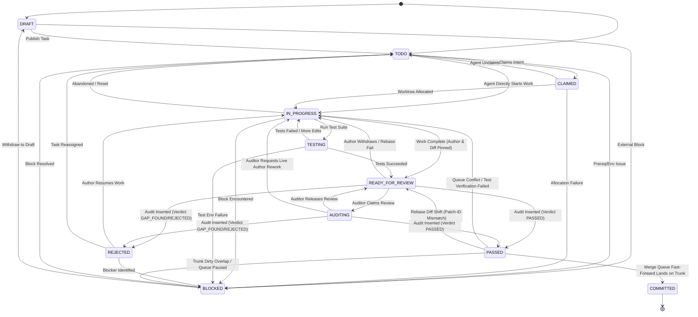

# AgentMesh Task State Machine Specification (v1.1)

Status: Draft for Review · Author: Gemini (Antigravity) · Task: S0.3  
Companion Schema: `docs/design/schema.sql` · Companion Tests: `docs/design/schema-tests.sql` · Attack Suite: `docs/design/claude-audit-s03.sql` · Worktree/Merge Queue: `docs/design/merge-queue.md`

---

## 1. Overview & Architectural Goals

The AgentMesh Task State Machine coordinates concurrent AI agents (Claude Code, Gemini/Antigravity, Cursor, etc.) and human supervisors across a shared codebase.

Key architectural invariants guaranteed by the state machine and schema:
1. **DAG Precondition Safety:** A task cannot be claimed or started until all prerequisite tasks have reached `PASSED` or `COMMITTED` status. Self-referential prerequisites are rejected at the database level.
2. **Strict Two-Agent Cross-Platform Rule (H2, H7):** An authoring agent cannot audit their own task, nor can another agent on the **same platform** (e.g., Claude Code CLI cannot audit another Claude Code CLI instance). Audits must cross platform boundaries (e.g., Gemini audits Claude; Claude audits Gemini). Human auditors (`paradigm = 'HUMAN'` and `platform = 'HUMAN'`) can audit any task. Fake human aliases are blocked by database triggers ensuring exactly one Human identity where `platform = 'HUMAN'` if and only if `paradigm = 'HUMAN'`. In addition, agent `platform` and `paradigm` are immutable after registration via trigger `trg_agents_immutable_identity` (H7), preventing agents from changing their platform to circumvent cross-platform audit rules.
3. **Audit Precondition & Immutability (H4, H5):** An audit can only be performed when a task is in `READY_FOR_REVIEW` or `AUDITING`, has an assigned author, and the audit's `diff_hash` exactly matches the task's pinned `diff_hash` (`STALE_AUDIT_DIFF` prevention). The `PASSED` verdict strictly requires `test_run_success = 1`. Audit records are append-only and strictly immutable.
4. **Stale Audit Invalidation on Pass (H3):** Direct status mutation to `PASSED` without an authentic audit record matching the task's current `diff_hash` is rejected by trigger. If a task returns to `READY_FOR_REVIEW` following a rebase patch shift, old audits cannot be reused to pass the task on a new diff.
5. **Submission Preconditions (H4, H5):** A task cannot transition to `READY_FOR_REVIEW` without an assigned author (`assigned_agent_id`) and a non-empty `diff_hash`.
6. **Merge-Queue Fidelity:** Audited patches are pinned by `diff_hash` and verified via `git patch-id --stable`. Any context shift during trunk rebase triggers a range-diff re-review (`READY_FOR_REVIEW`), while merge conflicts or verification failures bounce the task back to `IN_PROGRESS`.
7. **Human-in-the-Loop Integrity (H1):** Question resolution strictly requires a non-null `answered_by_agent_id`. Questions directed to Human (`to_role = 'Human'`) can only be answered by the verified Human agent.
8. **Platform-Agnostic Design & Resource Leases:** `questions` can be targeted to specific agents (`to_agent_id`), platforms (`to_platform`), or generic roles (`to_role IN ('Human', 'Agent', 'All')`), avoiding hardcoded platform names. Resource leases support `FILE` and `DIR` (`AST_SYMBOL` dropped in v1.1 per R8).
9. **Terminal State Integrity:** `COMMITTED` is an irreversible terminal state. Once landed on trunk, tasks cannot be reopened or mutated.

---

## 2. Task Lifecycle States

The `tasks.status` column is constrained to 11 discrete states:

| Status | Category | Definition |
|---|---|---|
| `DRAFT` | Initial | Task is being authored or planned; not yet ready for execution. |
| `TODO` | Ready | Task specification and acceptance criteria are finalized; awaiting assignment. |
| `BLOCKED` | Paused | Work cannot proceed due to external blockers, missing credentials, or queue freeze. |
| `CLAIMED` | Assigned | An agent has claimed intent to work on the task and is provisioning worktree/leases. |
| `IN_PROGRESS` | Active | Author agent is actively editing code, running commands, and committing changes. |
| `TESTING` | Active | Author agent is executing test suites and local verification in the task worktree. |
| `READY_FOR_REVIEW` | Review Gate | Author has completed work, pinned `diff_hash`, and submitted task for independent audit. |
| `AUDITING` | Active Review | An independent cross-platform auditor has claimed the review and is evaluating code/tests. |
| `PASSED` | Verified | Independent auditor (or Human) verified tests passed and approved diff; queued for landing. |
| `REJECTED` | Review Failed | Auditor detected test failures, gaps, or security flaws; awaiting author fixes. |
| `COMMITTED` | Terminal | Serial merge queue successfully fast-forwarded the task onto trunk. Irreversible. |

---

## 3. State Transition Diagram



---

## 4. Complete Transition Matrix

> [!IMPORTANT]
> **Enforcement Boundary: Daemon-Enforced vs. DB-Enforced**
> - **Authorized Actor (Daemon-Enforced via P1.3 / P1.4):** SQLite has no native caller identity or authenticated session concept. Therefore, *who* is authorized to perform a transition (e.g., verifying that only the assigned author agent transitions a task from `IN_PROGRESS` to `READY_FOR_REVIEW`, or only a peer auditor claims `AUDITING`) is enforced at the daemon layer by the **P1.3 Task State Machine Validator** using **P1.4 Agent Identity Tokens**.
> - **Trigger / Database Rule (DB-Enforced):** What the SQLite schema and database triggers natively guarantee and abort on (e.g., state transition validity, prerequisites satisfaction, author and diff_hash presence, audit verdict application, diff_hash matching, immutability, and single human identity).

The table below enumerates every legal transition permitted by `trg_task_status_transition` and its companion enforcement triggers in `docs/design/schema.sql`:

| # | From Status | To Status | Authorized Actor (Daemon-Enforced: P1.3/P1.4) | Trigger / Database Rule (DB-Enforced) | Business Trigger & Preconditions |
|---|---|---|---|---|---|
| 1 | `DRAFT` | `TODO` | Human / Planning Agent | `trg_task_status_transition` | Task definition, title, phase, and acceptance criteria are finalized. |
| 2 | `DRAFT` | `BLOCKED` | Human / Planning Agent | `trg_task_status_transition` | External dependency identified before publishing task. |
| 3 | `BLOCKED` | `TODO` | Human / Daemon | `trg_task_status_transition` | Blocker cleared; task ready to be picked up by agents. |
| 4 | `BLOCKED` | `DRAFT` | Human | `trg_task_status_transition` | Task demoted back to draft for redesign or requirement rewriting. |
| 5 | `TODO` | `CLAIMED` | Any Eligible Agent / Human | `trg_task_status_transition`, `trg_task_claim_prerequisites_check` | Agent signals claim. **Precondition:** All task prerequisites must be in `('PASSED', 'COMMITTED')`. |
| 6 | `TODO` | `IN_PROGRESS` | Any Eligible Agent / Human | `trg_task_status_transition`, `trg_task_claim_prerequisites_check` | Agent immediately allocates worktree and begins execution. Prerequisites must be satisfied. |
| 7 | `TODO` | `BLOCKED` | Human / Daemon | `trg_task_status_transition` | Prerequisite broke or external infrastructure failure. |
| 8 | `CLAIMED` | `IN_PROGRESS` | Assigned Author Agent | `trg_task_status_transition` | Git worktree successfully created (`.agentmesh/worktrees/wt-<taskId>`) and path leases acquired. |
| 9 | `CLAIMED` | `TODO` | Assigned Agent / Daemon | `trg_task_status_transition` | Agent releases claim prior to starting work (e.g. lease contention or shutdown). |
| 10 | `CLAIMED` | `BLOCKED` | Daemon / Human | `trg_task_status_transition` | Worktree provisioning failed or lease dispute encountered. |
| 11 | `IN_PROGRESS` | `TESTING` | Author Agent | `trg_task_status_transition` | Code edits complete; author agent runs test suite and builds in worktree. |
| 12 | `IN_PROGRESS` | `READY_FOR_REVIEW` | Author Agent | `trg_task_status_transition`, `trg_tasks_ready_for_review_update` | Author completes work, records `diff_hash`, and submits handoff. **Precondition:** `assigned_agent_id NOT NULL` and `diff_hash NOT NULL`. |
| 13 | `IN_PROGRESS` | `BLOCKED` | Author Agent / Human | `trg_task_status_transition` | Author encounters blocker requiring Human intervention or missing API key. |
| 14 | `IN_PROGRESS` | `TODO` | Author Agent / Human / Daemon | `trg_task_status_transition` | Task abandoned or heartbeat timeout; worktree cleaned up safely. |
| 15 | `TESTING` | `IN_PROGRESS` | Author Agent | `trg_task_status_transition` | Test failure or lint issue discovered; author resumes code modifications. |
| 16 | `TESTING` | `READY_FOR_REVIEW` | Author Agent | `trg_task_status_transition`, `trg_tasks_ready_for_review_update` | All tests pass, build succeeds. **Precondition:** `assigned_agent_id NOT NULL` and `diff_hash NOT NULL`. |
| 17 | `TESTING` | `BLOCKED` | Author Agent | `trg_task_status_transition` | Test environment failure or external mock service unreachable. |
| 18 | `READY_FOR_REVIEW` | `AUDITING` | Auditor Agent (Peer Platform) | `trg_task_status_transition` | Peer agent claims the review, starts examining diff and running tests. |
| 19 | `READY_FOR_REVIEW` | `PASSED` | Peer Auditor / Human (via Audit) | `trg_audit_apply_verdict`, `trg_audit_insert_validation`, `trg_task_prevent_unauthorized_pass` | Audit record inserted with `verdict = 'PASSED'`. **Preconditions:** Author assigned, diff_hash matches task diff_hash, cross-platform auditor rule satisfied, test_run_success = 1. |
| 20 | `READY_FOR_REVIEW` | `REJECTED` | Peer Auditor / Human (via Audit) | `trg_audit_apply_verdict`, `trg_audit_insert_validation` | Audit record inserted with `verdict IN ('REJECTED', 'GAP_FOUND')`. Automatically sets status to `REJECTED`. |
| 21 | `READY_FOR_REVIEW` | `IN_PROGRESS` | Author Agent / Daemon | `trg_task_status_transition` | Author withdraws submission, or merge queue rebase fails during fast-track. |
| 22 | `AUDITING` | `PASSED` | Peer Auditor / Human (via Audit) | `trg_audit_apply_verdict`, `trg_audit_insert_validation`, `trg_task_prevent_unauthorized_pass` | Auditor completes inspection: test run succeeded (`1`), checklist verified, audit row inserted with `verdict = 'PASSED'`. |
| 23 | `AUDITING` | `REJECTED` | Peer Auditor / Human (via Audit) | `trg_audit_apply_verdict`, `trg_audit_insert_validation` | Auditor finds defects or test failures; audit row inserted with `verdict = 'REJECTED'/'GAP_FOUND'`. |
| 24 | `AUDITING` | `READY_FOR_REVIEW` | Auditor Agent / Daemon | `trg_task_status_transition` | Auditor releases review without verdict (e.g. auditor context budget exhausted). |
| 25 | `AUDITING` | `IN_PROGRESS` | Auditor / Human | `trg_task_status_transition` | Auditor or Human rejects submission directly back to active drafting. |
| 26 | `REJECTED` | `IN_PROGRESS` | Author Agent | `trg_task_status_transition` | Author acknowledges audit gaps in `handoffs` and resumes work in worktree. |
| 27 | `REJECTED` | `BLOCKED` | Human / Author Agent | `trg_task_status_transition` | Architectural disagreement or dispute raised to Human via `questions`. |
| 28 | `REJECTED` | `TODO` | Human / Daemon | `trg_task_status_transition` | Task unclaimed and returned to pool for fresh reassignment. |
| 29 | `PASSED` | `COMMITTED` | Merge Queue Daemon | `trg_task_status_transition` | Merge queue executes `git -C <primary> merge --ff-only <branch>`; landed diff verified. |
| 30 | `PASSED` | `IN_PROGRESS` | Merge Queue Daemon | `trg_task_status_transition` | Trunk rebase had conflicts, or post-rebase verification tests failed. Author must resolve. |
| 31 | `PASSED` | `READY_FOR_REVIEW` | Merge Queue Daemon | `trg_task_status_transition` | Post-rebase `git patch-id` shifted due to context edits; requires range-diff re-review with updated `diff_hash`. Stale audit on old diff is invalidated. |
| 32 | `PASSED` | `BLOCKED` | Merge Queue Daemon | `trg_task_status_transition` | Primary tree has uncommitted dirty changes overlapping task files; queue pauses safely for Human. |

*Note: No transitions are permitted out of `COMMITTED` (terminal state).*

---

## 5. Detailed Trigger & Constraint Enforcement

### 5.1 Prerequisites & DAG Integrity
- **No Self-Prerequisites:**
  Triggers `trg_tasks_no_self_prerequisite_insert` and `trg_tasks_no_self_prerequisite_update` parse `prerequisites` via `json_each()`:
  ```sql
  SELECT RAISE(ABORT, 'Task cannot have itself as a prerequisite')
  FROM json_each(NEW.prerequisites)
  WHERE value = NEW.id;
  ```
- **Prerequisite Satisfaction on Claim/Start:**
  Trigger `trg_task_claim_prerequisites_check` intercepts updates transitioning from `('TODO', 'BLOCKED')` to `('CLAIMED', 'IN_PROGRESS')`:
  ```sql
  SELECT RAISE(ABORT, 'Cannot claim task: prerequisite ' || p.value || ' is not PASSED or COMMITTED')
  FROM json_each(NEW.prerequisites) p
  WHERE NOT EXISTS (
      SELECT 1 FROM tasks t
      WHERE t.id = p.value
        AND t.status IN ('PASSED', 'COMMITTED')
  );
  ```

### 5.2 Two-Agent Cross-Platform Audit Gate
- **Human Identity Integrity (`trg_agents_validate_human_insert`, `trg_agents_validate_human_update`) [H2]:**
  Prevents agents from registering fake human aliases (e.g. `platform = 'CLAUDE_CODE', paradigm = 'HUMAN'`):
  ```sql
  SELECT RAISE(ABORT, 'Human agent must have platform = ''HUMAN'' and paradigm = ''HUMAN''')
  WHERE (NEW.platform = 'HUMAN' AND NEW.paradigm != 'HUMAN')
     OR (NEW.paradigm = 'HUMAN' AND NEW.platform != 'HUMAN');

  SELECT RAISE(ABORT, 'Only one Human agent record is permitted')
  WHERE (NEW.platform = 'HUMAN' OR NEW.paradigm = 'HUMAN')
    AND EXISTS (
        SELECT 1 FROM agents WHERE (platform = 'HUMAN' OR paradigm = 'HUMAN') AND id != OLD.id
    );
  ```
- **Agent Platform & Paradigm Immutability (`trg_agents_immutable_identity`) [H7]:**
  Prevents registered agents from mutating their platform or paradigm post-registration to spoof another platform or circumvent cross-platform audit checks:
  ```sql
  CREATE TRIGGER IF NOT EXISTS trg_agents_immutable_identity
  BEFORE UPDATE OF platform, paradigm ON agents
  FOR EACH ROW
  WHEN NEW.platform IS NOT OLD.platform OR NEW.paradigm IS NOT OLD.paradigm
  BEGIN
      SELECT RAISE(ABORT, 'Agent platform and paradigm are immutable after registration');
  END;
  ```
- **Author & diff_hash Submission Requirement (`trg_tasks_ready_for_review_insert`, `trg_tasks_ready_for_review_update`) [H4, H5]:**
  ```sql
  SELECT RAISE(ABORT, 'Task cannot be READY_FOR_REVIEW without an assigned author')
  WHERE NEW.assigned_agent_id IS NULL;

  SELECT RAISE(ABORT, 'Task cannot be READY_FOR_REVIEW without diff_hash')
  WHERE NEW.diff_hash IS NULL OR trim(NEW.diff_hash) = '';
  ```
- **Audit Precondition & Validation (`trg_audit_insert_validation`) [H2, H4, H5]:**
  1. Target task must be in `READY_FOR_REVIEW` or `AUDITING`.
  2. Target task must have an assigned author (`t.assigned_agent_id IS NOT NULL`). (H4)
  3. Audit `diff_hash` must match task pinned `diff_hash` (`STALE_AUDIT_DIFF`). (H5)
  4. Cross-platform validation:
     ```sql
     SELECT RAISE(ABORT, 'Two-agent rule violation: auditor platform must differ from author platform')
     FROM tasks t
     JOIN agents author ON author.id = t.assigned_agent_id
     JOIN agents auditor ON auditor.id = NEW.auditor_agent_id
     WHERE t.id = NEW.task_id
       AND NOT (auditor.paradigm = 'HUMAN' AND auditor.platform = 'HUMAN')
       AND (
           auditor.id = author.id
           OR auditor.platform = author.platform
       );
     ```
  5. Test run success gate: `NEW.verdict = 'PASSED'` requires `NEW.test_run_success = 1`.
- **Automatic Status Application (`trg_audit_apply_verdict`):**
  - If `verdict = 'PASSED'`, `tasks.status` automatically transitions to `PASSED`.
  - If `verdict IN ('REJECTED', 'GAP_FOUND')`, `tasks.status` automatically transitions to `REJECTED`.
  - `tasks.reviewing_agent_id` is updated to `NEW.auditor_agent_id`.
- **Stale Audit Re-Use Prevention (`trg_task_prevent_unauthorized_pass`) [H3]:**
  Prevents status jump to `PASSED` without a matching `PASSED` audit for the task's current `diff_hash`:
  ```sql
  SELECT RAISE(ABORT, 'Cannot transition task to PASSED without a corresponding PASSED audit record')
  WHERE NEW.diff_hash IS NULL
     OR NOT EXISTS (
      SELECT 1 FROM audits a
      WHERE a.task_id = NEW.id
        AND a.verdict = 'PASSED'
        AND a.diff_hash = NEW.diff_hash
  );
  ```
- **Audit Immutability (`trg_audits_prevent_update`, `trg_audits_prevent_delete`):**
  Audit records cannot be modified or deleted.

### 5.3 Merge Queue & Landing Transitions
As defined in `docs/design/merge-queue.md`:
1. **FIFO Ingestion:** When a task reaches `PASSED`, the daemon merge queue processes it.
2. **Rebase & Verification:**
   - The task branch is rebased onto `main`: `git -C <wt> rebase main`.
   - If rebase conflicts: status shifts `PASSED` -> `IN_PROGRESS` with `conflict` details logged.
   - Audited patch-id is re-checked: `git -C <wt> diff main HEAD | git patch-id --stable`.
   - If patch-id changed: status shifts `PASSED` -> `READY_FOR_REVIEW` for range-diff re-review with updated `diff_hash`.
   - Verification command runs (`npm test && npm run build`): if failed, status shifts `PASSED` -> `IN_PROGRESS`.
3. **Fast-Forward Landing:**
   - Primary tree fast-forwards: `git -C <primary> merge --ff-only mesh/<taskId>-<slug>`.
   - Status updates: `UPDATE tasks SET status = 'COMMITTED' WHERE id = ?`.
   - If primary tree has overlapping dirty files, git refuses safely; queue sets `PASSED` -> `BLOCKED` and alerts Human.
4. **Cleanup:**
   - Unlink junction: `cmd /c rmdir <wt>\node_modules` (Windows) / `unlink` (POSIX).
   - Remove worktree: `git worktree remove <wt>`.
   - Delete task branch: `git branch -d mesh/<taskId>-<slug>`.

### 5.4 Human-in-the-Loop & Question Addressing (H1)
Triggers `trg_questions_resolve_check` and `trg_questions_resolve_insert_check`:
- Questions cannot be marked `resolved = 1` without a non-empty `answer`.
- Questions cannot be resolved without specifying `answered_by_agent_id` (`NOT NULL`).
- Questions directed to Human (`to_role = 'Human'`) can **only** be answered by an agent registered with `paradigm = 'HUMAN'` and `platform = 'HUMAN'`. Software agents attempting to resolve Human questions are rejected.
- Questions support platform-agnostic addressing via `to_platform`, `to_agent_id`, and `to_role IN ('Human', 'Agent', 'All')`.

---

## 6. Verification Against Test Suite

The state machine design and SQLite triggers are verified against `docs/design/schema-tests.sql` and `docs/design/claude-audit-s03.sql` using Node 24's built-in SQLite engine.

### Canonical Tests (`schema-tests.sql`):
- Block 1: Seeds cross-platform agents and tasks.
- Block 2: Legal transition `TODO` -> `IN_PROGRESS`.
- Block 3: Illegal jump `TODO` -> `PASSED` aborted.
- Block 4: Illegal jump `IN_PROGRESS` -> `COMMITTED` aborted.
- Block 5: Prerequisite check blocks claiming dependent task whose prerequisite is still in progress.
- Block 6: Cyclic self-prerequisite insert aborted.
- Block 7: Legal transition `IN_PROGRESS` -> `READY_FOR_REVIEW`.
- Block 8: Premature audit of task in `TODO` status aborted.
- Block 9: Self-audit by same author agent aborted.
- Block 10: Same-platform audit (Claude CLI 2 auditing Claude CLI 1) aborted under two-agent platform rule.
- Block 11: Cross-platform audit by Gemini on Claude task records `GAP_FOUND` -> task transitions to `REJECTED`.
- Block 12: Author resumes work `REJECTED` -> `IN_PROGRESS`.
- Block 13: Author resubmits fixed diff `IN_PROGRESS` -> `READY_FOR_REVIEW`.
- Block 14: Human auditor approves fix `READY_FOR_REVIEW` -> `PASSED`.
- Block 15: Modification of audit record rejected (audit immutability).
- Block 16: Dependent task now claimable since prerequisite is `PASSED`.
- Block 17: Merge queue fast-forward lands task `PASSED` -> `COMMITTED`.
- Block 18: Reopening committed task `COMMITTED` -> `IN_PROGRESS` aborted (terminal state).
- Block 19: AI agent attempting to answer question directed to Human aborted.
- Block 20: Human successfully answers and resolves question directed to Human.
- Block 21: AST_SYMBOL lease type rejected under v1.1 resource constraints.
- Block 22: Transition to `READY_FOR_REVIEW` without author rejected.
- Block 23: Transition to `READY_FOR_REVIEW` without `diff_hash` rejected.
- Block 24: Audit of mismatched `diff_hash` rejected (`STALE_AUDIT_DIFF`).
- Block 25: Resolving question without `answered_by_agent_id` rejected.

### Attack Vector Verification (`claude-audit-s03.sql`):
- **H1 Block:** Attempt to resolve Human-directed question without answerer id is aborted by trigger (`Cannot resolve question without specifying answered_by_agent_id`).
- **H2 Block:** Attempt to register fake human alias (`claude-as-human`) is aborted by trigger (`Human agent must have platform = 'HUMAN' and paradigm = 'HUMAN'`).
- **H3 Block:** Attempt to pass task on new diff hash using stale audit from prior diff is aborted by trigger (`Cannot transition task to PASSED without a corresponding PASSED audit record`).
- **H4 Block:** Attempt to transition unauthored task to `READY_FOR_REVIEW` is aborted by trigger (`Task cannot be READY_FOR_REVIEW without an assigned author`).
- **H5 Block:** Attempt to audit task with different diff hash is aborted by trigger (`Audit diff_hash does not match task pinned diff_hash (STALE_AUDIT_DIFF)`).

### Attack Vector Verification — Round 2 (`claude-audit-s03-round2.sql`):
- **H6 Block:** Author agent deleted post-submission (`assigned_agent_id` set to NULL via ON DELETE SET NULL); peer audit attempt is aborted by trigger (`Task must have an assigned author to be audited`).
- **H7 Block:** Agent attempts to change `platform` from `CLAUDE_CODE` to `ANTIGRAVITY` after registration; aborted by trigger (`Agent platform and paradigm are immutable after registration`).
- **H8 Block:** Attempt to register a second well-formed Human identity (`paradigm = 'HUMAN', platform = 'HUMAN'`) is aborted by trigger (`Only one Human agent record is permitted`).

